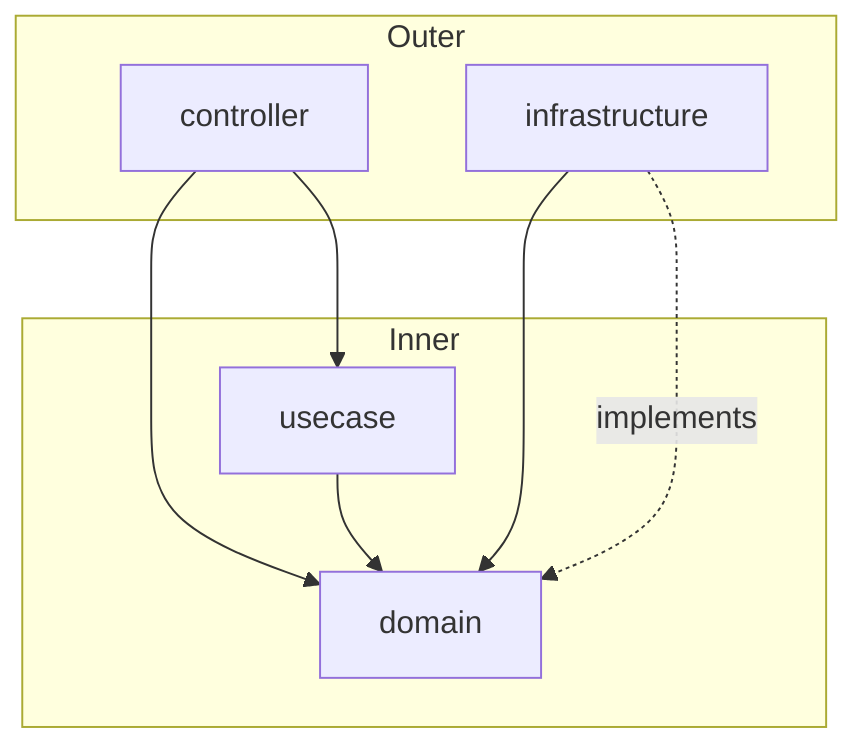

# Spring Boot 4 Clean Architecture Template (Java 21, Hexagonal Microservice)

A production-grade **Spring Boot 4 / Java 21 Clean Architecture** (hexagonal, ports and adapters) **microservice template** with **ArchUnit-enforced layer boundaries**, **multi-tenant MySQL**, **transactional outbox → Kafka**, Redis, a full local stack, BDD + Testcontainers, security and quality gates, and first-class AI-agent docs. It is ready to fork, not a toy sample.

> [!TIP]
> **📖 Read the full documentation at [olx-india.github.io/java-service-template-clean-architecture](https://olx-india.github.io/java-service-template-clean-architecture/)**: architecture guide, transactional outbox, local setup, ADRs, runbook and AI-agent workflows, all searchable in one place.

[](https://olx-india.github.io/java-service-template-clean-architecture/)
[](https://github.com/olx-india/java-service-template-clean-architecture/generate)

Then run `make init PACKAGE=com.acme.orders ARTIFACT=orders-service APP=OrdersApplication` to get a clean, renamed service.

Maintained by [OLX India](https://github.com/olx-india) · [Apache License 2.0](LICENSE) · If this template saves you time, please ⭐ star the repo so other teams can find it.

[](https://docs.oracle.com/en/java/javase/21/)
[](https://spring.io/projects/spring-boot)
[](https://maven.apache.org/)
[](https://opensource.org/licenses/Apache-2.0)
[](https://github.com/olx-india/java-service-template-clean-architecture/actions/workflows/package-verify.yml)
[](https://olx-india.github.io/java-service-template-clean-architecture/)
[](https://github.com/olx-india/java-service-template-clean-architecture/stargazers)

---

## Why this template

**Who it's for:** teams bootstrapping a new Java microservice that need Clean Architecture with production patterns (tenancy, events, cache, observability)—not a minimal hexagonal skeleton.

What sets it apart from typical starters:

- **ArchUnit-enforced Clean Architecture** — domain and use cases cannot depend on infrastructure; violations fail the build
- **Database-per-tenant MySQL** — with read/write replica routing
- **Transactional outbox → Kafka** — events written atomically with business data, then relayed; see [docs/outbox-pattern.md](docs/outbox-pattern.md)
- **Production-shaped tests** — Cucumber BDD + Testcontainers (MySQL, Redis, Kafka); no private dependencies
- **Ops-ready defaults** — Resilience4j, optional JWT, Prometheus, OpenTelemetry, SpotBugs, OWASP dependency-check
- **AI-agent DX** — [AGENTS.md](AGENTS.md) and [docs/ai-agents.md](docs/ai-agents.md) for Cursor / Claude Code

### How it compares

| | Spring Initializr | Typical hexagonal sample | **This template** |
|--|:--:|:--:|:--:|
| Clean / hexagonal layer layout | – | ✅ | ✅ |
| Layer rules enforced in the build (ArchUnit) | – | rarely | ✅ |
| Multi-tenant datasource with read/write routing | – | – | ✅ |
| Transactional outbox → Kafka | – | – | ✅ |
| Testcontainers + Cucumber integration tests | – | sometimes | ✅ |
| Observability, resilience, security defaults | – | – | ✅ |
| One-command reset and rename (`make init`) | n/a | – | ✅ |
| AI-agent instructions (AGENTS.md, Cursor rules) | – | – | ✅ |



---

## Quick start

```bash
git clone https://github.com/olx-india/java-service-template-clean-architecture.git
cd java-service-template-clean-architecture

export JAVA_HOME=$(/usr/libexec/java_home -v 21)   # macOS
cp .env.example .env                                # optional

make dev
```

`make dev` loads `.env`, starts Docker infrastructure (MySQL, Redis, Kafka), runs Flyway migrations, and starts the Spring Boot server.

**Prerequisites:** JDK 21, Docker & Docker Compose, Git. Make is optional but recommended.

**Manual steps** (if you prefer):

```bash
make docker-up
make migrate
make run
```

| | URL |
|--|-----|
| API | http://localhost:8080 |
| Swagger UI | http://localhost:8080/swagger-ui/index.html |
| Actuator (metrics) | http://localhost:8081/metrics |

Use the `X-Default-Tenant: default` header on API requests.

More detail: [docs/local-setup.md](docs/local-setup.md)

---

## What's included

| Area | Capabilities |
|------|----------------|
| **Architecture** | Clean Architecture layers, ArchUnit boundaries, use-case + command pattern |
| **Data** | Multi-tenant MySQL, Flyway, JPA ports/adapters, R/W routing |
| **Messaging** | Transactional outbox, `EventPublisher` port, Kafka relay |
| **Cache** | Redis + Spring Cache, actuator eviction |
| **API** | REST, Bean Validation, SpringDoc OpenAPI, consistent error handling |
| **Ops** | Resilience4j, optional JWT, Prometheus, OTel, health probes, correlation IDs |
| **Quality** | SpotBugs, OWASP dependency-check, JaCoCo, Eclipse formatter |
| **Testing** | JUnit 5, Mockito, Cucumber, Testcontainers, RestAssured |
| **DX** | `make dev`, Docker Compose, `.env.example`, Maven wrapper, AI-agent docs |

Full breakdown: [docs/features.md](docs/features.md)

### Tech stack

| Category | Technology |
|----------|------------|
| Runtime | Java 21 |
| Framework | Spring Boot 4.0.9 |
| Build | Maven 3.6+ (wrapper included) |
| Database | MySQL 8, Flyway |
| Cache | Redis, Spring Cache |
| Messaging | Apache Kafka |
| API docs | SpringDoc OpenAPI |
| Testing | JUnit 5, Mockito, Cucumber, Testcontainers, RestAssured |

---

## Project structure

```
├── src/main/java/com/olx/boilerplate/
│   ├── controller/           # REST API, DTOs
│   ├── usecase/              # Application use cases and commands
│   ├── domain/               # Entities, ports, domain exceptions
│   │   └── repository/       # Repository port interfaces
│   └── infrastructure/       # JPA, Redis, Kafka, config, security
├── src/test/
│   ├── java/.../ut/          # Unit tests + ArchUnit
│   └── java/.../it/          # Cucumber + Testcontainers integration tests
├── docs/                     # Architecture, features, setup, runbook
├── docker-compose-local.yml  # MySQL, Redis, Kafka, OTel collector
├── Makefile                  # build, test, dev, migrate
└── pom.xml
```

| Layer | Responsibility |
|-------|----------------|
| **Controller** | HTTP, validation, DTO ↔ command mapping |
| **Use case** | Application workflows |
| **Domain** | Entities, ports, business rules |
| **Infrastructure** | Adapters and framework wiring |

Deep dive: [docs/clean-architecture.md](docs/clean-architecture.md) · [docs/low-level-design.md](docs/low-level-design.md)

---

## Commands

```bash
make dev               # Load .env, start infra, migrate, run server
make build             # Package (skip integration tests)
make test              # Unit tests
make it                # Cucumber IT (≈ CI integration-tests job; needs Docker)
make verify            # Unit + SpotBugs + formatter + JaCoCo (≈ CI verify job; skips OWASP)
make verify-all        # Full verify including OWASP (slow; also weekly CI)
make spotbugs          # SpotBugs only
make dependency-check  # OWASP only
make security          # SpotBugs + OWASP
make docker-up         # Start infrastructure containers only
make docker-down       # Stop containers
make migrate           # Run Flyway migrations (loads .env)
make run               # Start Spring Boot (infra must already be up)
make format            # Apply Eclipse formatter
make init PACKAGE=com.acme.orders ARTIFACT=orders-service APP=OrdersApplication
                       # New service: remove User/Order samples, rename, format, test
make rename PACKAGE=... ARTIFACT=... APP=...
                       # Rename package/artifact/main class only (keeps samples)
                       # Both accept DRY_RUN=1 (preview) and FORCE=1 (dirty git tree)
```

**Local Docker:** `make docker-up` starts MySQL, Redis, Kafka, and the OTel collector only. Run the app with `make run` or `make dev`. Do not start a packaged `myapp` container for day-to-day local development.

**Configuration:** profiles `local` and `integration-test` in `application*.yaml`. Copy [`.env.example`](.env.example) for `DB_HOST`, `REDIS_HOST`, `KAFKA_HOST`, `SCHEMAS_TO_MIGRATE`, etc. Optional auth: `spring.security.enabled=true` with `security.mode=hmac` (JWT secret) or `security.mode=oidc` (`OAUTH2_JWK_SET_URI`).

**CI:** two stages — `verify` (`mvn verify -DskipIntegration=true`) and separate `integration-tests` (`make it`).

---

## Customize for your service

One command resets the template and renames it:

```bash
make init PACKAGE=com.acme.myservice ARTIFACT=myservice APP=MyServiceApplication DRY_RUN=1   # preview
make init PACKAGE=com.acme.myservice ARTIFACT=myservice APP=MyServiceApplication             # apply
```

`make init` removes the sample User/Order features and keeps the package layout and platform pieces (tenancy, outbox, Kafka, Redis, health). It then renames the package, artifact and main class, formats the code and runs unit tests. Use `make rename` instead to keep the samples. Variables and the full list of changed files: [docs/template-setup.md](docs/template-setup.md).

Then add your first feature:

1. Add a domain entity and repository port under `domain/`
2. Add a command + use case under `usecase/`
3. Add request/response DTOs and a controller under `/api/v1/...`
4. Implement the repository adapter in `infrastructure/data/repository/`
5. Add a Flyway migration under `db/migration/common/`
6. Add unit tests and a Cucumber scenario

API calls need the `X-Default-Tenant: default` header. Sample APIs (until you run `make init`): `/api/v1/users`, `/api/v1/orders`.

---

## Documentation

**🌐 Documentation site: <https://olx-india.github.io/java-service-template-clean-architecture/>**. All guides below are published there with search, navigation and dark mode.

| Topic | Link |
|-------|------|
| Local setup | [docs/local-setup.md](docs/local-setup.md) |
| Features | [docs/features.md](docs/features.md) |
| Clean architecture | [docs/clean-architecture.md](docs/clean-architecture.md) |
| ADRs | [docs/adr/](docs/adr/README.md) |
| Transactional outbox | [docs/outbox-pattern.md](docs/outbox-pattern.md) |
| AI agents (Cursor / Claude) | [AGENTS.md](AGENTS.md) · [docs/ai-agents.md](docs/ai-agents.md) |
| Low-level design | [docs/low-level-design.md](docs/low-level-design.md) |
| Runbook | [docs/runbook.md](docs/runbook.md) |
| All docs | [docs/README.md](docs/README.md) · [docs site](https://olx-india.github.io/java-service-template-clean-architecture/) |

---

## FAQ

### Build fails with Lombok or “Unsupported class file major version”

Use **JDK 21**: `export JAVA_HOME=$(/usr/libexec/java_home -v 21)` and use `./mvnw -s settings.xml` if your global Maven settings point to a private repository.

### Where do I configure the environment?

See [docs/local-setup.md](docs/local-setup.md) and [`.env.example`](.env.example).

---

## Contributing

See [CONTRIBUTING.md](CONTRIBUTING.md), [CODE_OF_CONDUCT.md](CODE_OF_CONDUCT.md), and [SECURITY.md](SECURITY.md).

Template change history (by date): [CHANGELOG.md](CHANGELOG.md)

---

## License

Apache License 2.0 — see [LICENSE](LICENSE).
